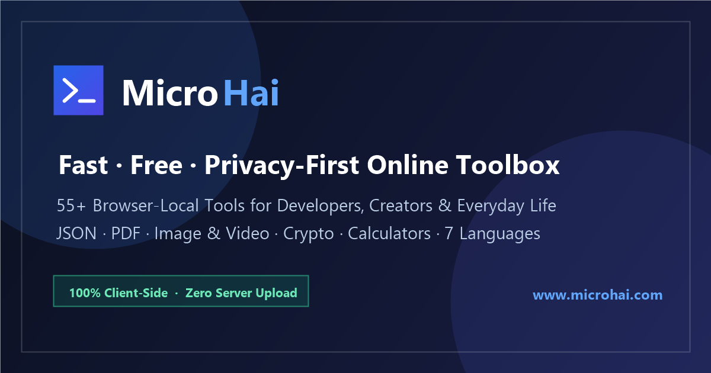

# ⚡ MicroHai — Outils Web 100% Locaux

**Plus de 70 outils en ligne gratuits, rapides et respectueux de la vie privée, exécutés 100% dans votre navigateur sans aucun téléversement.**

[English](./README.md) · [简体中文](./README.zh-CN.md) · [Español](./README.es.md) · **Français** · [Português](./README.pt.md) · [日本語](./README.ja.md) · [한국어](./README.ko.md)

   

### 👉 [Ouvrir MicroHai Toolbox (https://www.microhai.com/fr)](https://www.microhai.com/fr)

---

## 🔒 Pourquoi Local-First ?

- **Confidentialité 100% locale** : vos PDF, logs, images, vidéos et clés de chiffrement ne quittent jamais votre appareil.
- **Instantané et sans inscription** : aucun compte requis, aucun filigrane et fonctionnement ultra-rapide.
- **71+ outils tout-en-un** : développement & code, texte & PDF, médias/images/vidéos, sécurité & crypto, et utilitaires du quotidien.
- **Support natif en 7 langues** : Anglais, Chinois, Espagnol, Français, Portugais, Japonais et Coréen.

---

## 🧰 Catalogue Complet des Outils (71)

### Dév & Code (16)

> Formateur/diff/Excel JSON, Regex, testeur HTTP/WebSocket, générateur UUID/ULID et convertisseurs YAML/CSV/XML — [Voir la catégorie →](https://www.microhai.com/fr/category/dev)

| Outil | Description |
| :--- | :--- |
| [**Formateur / Vue Arbre / Minificateur JSON**](https://www.microhai.com/fr/tools/json-formatter) | Formatez, validez, colorez la syntaxe, explorez en arbre, minifiez en 1 ligne et échappez le JSON |
| [**Chiffrement & Masquage JSON par Champ**](https://www.microhai.com/fr/tools/json-crypto) | Chiffrez/déchiffrez les valeurs JSON en AES/DES/Base64 en gardant les clés intactes ou masquez les PII |
| [**Obfuscateur & Désobfuscateur JSON**](https://www.microhai.com/fr/tools/json-obfuscator) | Obfusquez vos données JSON avec des séquences Unicode (\uXXXX) et un mappage de clés hexadécimal |
| [**Obfuscateur & Désobfuscateur JS (Avancé)**](https://www.microhai.com/fr/tools/js-obfuscator) | Protégez votre JavaScript avec String Array, encodage Base64/Hex/Unicode, renommage, code mort et anti-débogage |
| [**Comparateur JSON (Diff Structurel)**](https://www.microhai.com/fr/tools/json-diff) | Comparez deux JSON en profondeur en soulignant les ajouts, suppressions et modifications avec JSONPath |
| [**Générateur d’Entités depuis JSON**](https://www.microhai.com/fr/tools/json-to-entity) | Générez des interfaces TypeScript, classes Java, structs Go, dataclasses Python et classes C# depuis JSON |
| [**Convertir JSON vers Excel / CSV**](https://www.microhai.com/fr/tools/json-to-excel) | Prévisualisez les tableaux JSON, aplatissez les objets imbriqués et exportez en Excel (.xls) ou CSV |
| [**Convertisseur JSON / YAML / CSV / XML / TS**](https://www.microhai.com/fr/tools/data-converter) | Convertissez facilement entre JSON, YAML, tableaux CSV, XML et générez des interfaces TypeScript |
| [**Convertisseur Timestamp Unix & Bases**](https://www.microhai.com/fr/tools/dev-converter) | Timestamp Unix (sec/ms) et convertisseur de bases numériques 2/8/10/16/36 avec BigInt |
| [**Convertisseur de Couleurs (HEX / RGB / HSL)**](https://www.microhai.com/fr/tools/color-converter) | Sélecteur de couleur avec opacité Alpha, canaux RGB modifiables, sorties CSS et contraste |
| [**Testeur d’Expressions Régulières (Regex)**](https://www.microhai.com/fr/tools/regex-tester) | Surlignage des correspondances en temps réel, groupes de capture, modèles courants et remplacement |
| [**Testeur WebSocket en Ligne**](https://www.microhai.com/fr/tools/websocket-tester) | Connectez-vous à ws:// et wss://, envoyez Text/JSON/Hex/Base64, activez le heartbeat auto et inspectez les logs |
| [**Testeur d’API HTTP en Ligne**](https://www.microhai.com/fr/tools/http-tester) | Envoyez des requêtes GET/POST/PUT/DELETE avec Params, En-têtes, Auth, JSON/Form et exportez en cURL |
| [**Scanner de Ports en Ligne**](https://www.microhai.com/fr/tools/port-scanner) | Sondez les ports Web/API locaux et LAN via HTTP/HTTPS et générez des commandes nmap/PowerShell |
| [**Chaîne ⇄ Hex / Binaire / Octal / Décimal**](https://www.microhai.com/fr/tools/string-base-converter) | Convertisseur bidirectionnel modifiable UTF-8 avec préfixe 0x, espaces et majuscules |
| [**Générateur en Masse UUID v4 / v7 & ULID**](https://www.microhai.com/fr/tools/uuid-ulid-generator) | Générez 1–1000 UUID v7, UUID v4 et ULID en texte, JSON, SQL IN ou CSV + inspecteur d’horodatage |

### Texte & Mise en forme (12)

> Markdown vers HTML/Image/PDF, boîte à outils PDF (fusionner, diviser, convertir), comparateur Diff et compteur de mots — [Voir la catégorie →](https://www.microhai.com/fr/category/text)

| Outil | Description |
| :--- | :--- |
| [**Éditeur Markdown & Convertisseur HTML**](https://www.microhai.com/fr/tools/markdown-converter) | Aperçu GFM en direct, extraction du code HTML et exportation en fichier .html stylisé |
| [**Exporter Markdown en Image & PDF**](https://www.microhai.com/fr/tools/markdown-to-image-pdf) | Convertissez Markdown en cartes PNG/JPG Retina 2x ou documents PDF vectoriels A4 avec 3 thèmes |
| [**Fusionner, Diviser & Supprimer Pages PDF**](https://www.microhai.com/fr/tools/pdf-toolkit) | Fusionnez des PDF, divisez par plages ou toutes les N pages et supprimez/réorganisez les pages localement |
| [**Convertir en PDF (Word, Excel, PPTX, EPUB, HTML, PNG, JPG)**](https://www.microhai.com/fr/tools/convert-to-pdf) | Convertissez Word (.docx), Excel (.xlsx/.xls), PPTX, EPUB, HTML, PNG et JPG en PDF 100% localement |
| [**Convertisseur PDF (Word, PNG, JPG, EPUB, Excel, PPTX, HTML, TXT)**](https://www.microhai.com/fr/tools/pdf-converter) | Convertissez PDF en Word (.docx), PNG, JPG (ZIP), EPUB, Excel (.xlsx), PPTX, HTML et TXT localement |
| [**Diff de Texte / Déduplication / Compteur**](https://www.microhai.com/fr/tools/text-processor) | Supprimez les doublons, triez les lignes, ajoutez préfixes/suffixes, listes SQL IN et comparez deux textes |
| [**Signature Électronique Manuscrite (PNG Transparent / SVG)**](https://www.microhai.com/fr/tools/signature-pad) | Dessinez votre signature à la souris, au doigt ou au stylet, recadrez automatiquement et exportez en PNG transparent ou SVG |
| [**Caviardage & Masquage Permanent de PDF (100% Local)**](https://www.microhai.com/fr/tools/pdf-redactor) | Masquez définitivement noms, téléphones, e-mails et cartes dans un PDF par aplatissement en pixels et suppression des métadonnées |
| [**Filigrane & Tampon ANNULÉ/VOID PDF en Lot (100% Local)**](https://www.microhai.com/fr/tools/pdf-watermark) | Ajoutez un filigrane anti-vol en mosaïque, un tampon CONFIDENTIEL/VOID ou un logo PNG sur plusieurs PDF à la fois avec export ZIP |
| [**Découpeur & Fusionneur Local de Gros Fichiers Texte / Logs**](https://www.microhai.com/fr/tools/text-log-splitter) | Découpez des fichiers TXT, LOG, CSV et JSONL de 100 Mo à 2 Go+ par taille, lignes, N parties ou regex sans planter, ou fusionnez-les sans perte |
| [**Générateur de Polices Fantaisie, Symboles Spéciaux & Emojis**](https://www.microhai.com/fr/tools/fancy-text-symbols) | Créez 24+ polices Unicode (cursive, gothique, gras, cerclé, inversé) avec cadres décoratifs, plus symboles spéciaux, emojis et kaomoji à copier-coller |
| [**Générateur de Nuage de Mots en Ligne (PNG HD & SVG Vecteur)**](https://www.microhai.com/fr/tools/word-cloud-generator) | Créez des nuages de mots en forme de nuage, cœur, cercle ou étoile depuis un texte ou CSV, avec 8 palettes et export PNG transparent / SVG |

### Médias & Images (16)

> Compresseur, floutage/mosaïque, filigrane, fusion, EXIF, convertisseur WebP/Base64, pipette couleur, vidéo vers GIF et enregistreur d’écran — [Voir la catégorie →](https://www.microhai.com/fr/category/media)

| Outil | Description |
| :--- | :--- |
| [**Compresseur & Convertisseur d’Image (WebP/PNG/JPG)**](https://www.microhai.com/fr/tools/image-compressor) | Compressez vos images et convertissez entre WebP, JPEG et PNG localement dans votre navigateur |
| [**Filigrane & Redimensionneur d’Image**](https://www.microhai.com/fr/tools/image-watermark) | Ajoutez un filigrane diagonal en mosaïque pour documents d’identité ou une signature en coin localement |
| [**Convertisseur Image ⇄ Base64**](https://www.microhai.com/fr/tools/image-base64) | Convertissez des images en DataURL Base64, balises HTML/CSS, ou décodez Base64 vers image |
| [**Convertisseur de Formats d’Image**](https://www.microhai.com/fr/tools/image-converter) | Convertissez par lots PNG, JPG, WebP, SVG, GIF, BMP, AVIF et ICO localement avec contrôle de qualité |
| [**Visionneuse & Suppresseur EXIF**](https://www.microhai.com/fr/tools/exif-tool) | Inspectez appareil photo, GPS, XMP et métadonnées PNG localement et supprimez-les sans perte |
| [**Pipette Couleur & Extracteur de Palette**](https://www.microhai.com/fr/tools/image-color-picker) | Prélevez HEX/RGB/HSL sur vos images et extrayez les couleurs dominantes en CSS, JSON ou PNG |
| [**Extracteur d’Images Vidéo**](https://www.microhai.com/fr/tools/video-frame-extractor) | Extrayez des images PNG/JPG/WebP depuis vos vidéos MP4/WebM/MOV localement avec export ZIP |
| [**Fusionneur d’Images & Collage**](https://www.microhai.com/fr/tools/image-merger) | Assemblez plusieurs images verticalement, horizontalement ou en grille avec marges, coins arrondis et export PNG/JPG/WebP |
| [**Convertisseur Vidéo en GIF (MP4 / WebM / MOV)**](https://www.microhai.com/fr/tools/video-to-gif) | Convertissez vos vidéos MP4/WebM/MOV en GIF animés localement : découpe, FPS, vitesse, Inversé/Boomerang et légende |
| [**Floutage & Mosaïque Partielle d’Image (Local)**](https://www.microhai.com/fr/tools/image-mosaic-blur) | Floutez ou pixélisez des visages, plaques ou données sensibles localement (Mosaïque, Flou Gaussien, Masque) + Ctrl+V |
| [**Enregistreur d’Écran & Webcam en Ligne (PiP / Sans Filigrane)**](https://www.microhai.com/fr/tools/screen-recorder) | Enregistrez écran, webcam ou Écran + Webcam PiP en local avec audio système + micro, 30/60fps, pause et téléchargement WebM/MP4 |
| [**Générateur d’Affiche Onde Sonore & Spectre Audio**](https://www.microhai.com/fr/tools/audio-soundwave-poster) | Transformez vos MP3/WAV ou messages vocaux en affiches d’onde sonore (5 styles, 8 thèmes, 3:4/1:1/16:9/9:16, PNG HD & SVG) |
| [**Rendre une Vidéo Muette / Supprimer l’Audio (MP4 / MOV / WebM)**](https://www.microhai.com/fr/tools/video-mute-remover) | Retirez la piste audio d’un MP4/MOV instantanément sans perte (< 1s) ou ré-encodez en local avec découpe optionnelle |
| [**Superposition d’Images & Double Exposition (Calques PNG)**](https://www.microhai.com/fr/tools/image-overlay) | Superposez logos PNG, stickers, tampons ou photos par glisser-déposer avec opacité, rotation, coins arrondis et 10 modes de fusion |
| [**Générateur d’Art ASCII à partir d’Image (Couleur / PNG)**](https://www.microhai.com/fr/tools/image-to-ascii) | Convertissez vos photos en art ASCII couleur ou monochrome (6 jeux de caractères, contraste, Ctrl+V) avec export TXT, HTML et PNG HD |
| [**Convertisseur Photo en Pixel Art & Mosaïque (8-Bit / Perles Hama)**](https://www.microhai.com/fr/tools/pixel-art-converter) | Transformez vos photos en pixel art 8-bit, modèles Perler/Hama, briques, diamant ou point de croix avec 8 palettes rétro et tramage |

### Sécurité & Crypto (5)

> Chiffrement AES/DES/RC4, hash MD5/SHA256/HMAC, débogueur JWT, générateur de mots de passe et Base64/URL/Hex — [Voir la catégorie →](https://www.microhai.com/fr/category/security)

| Outil | Description |
| :--- | :--- |
| [**Chiffrement AES / DES / 3DES / RC4**](https://www.microhai.com/fr/tools/symmetric-crypto) | Chiffrement et déchiffrement symétrique avec modes CBC/ECB/CTR, padding Pkcs7 et sortie Base64/Hex |
| [**Générateur de Hash MD5 / SHA256 / HMAC**](https://www.microhai.com/fr/tools/hash-generator) | Calculez MD5 (16/32 bits), SHA1, SHA256, SHA512, SHA3, RIPEMD160 et signatures HMAC simultanément |
| [**Encodeur Base64 / URL / Hex / Unicode**](https://www.microhai.com/fr/tools/codec-converter) | Encodeur/décodeur Base64 et Base64URL (JWT) compatible UTF-8, URL, Hex et séquences Unicode |
| [**Générateur de Mots de Passe**](https://www.microhai.com/fr/tools/password-generator) | Générez des mots de passe robustes et phrases secrètes localement via Web Crypto avec calcul d’entropie |
| [**Suite JWT (Decode / Generate / Verify / JWS)**](https://www.microhai.com/fr/tools/jwt-suite) | Décodez, signez (HS/RS/ES), vérifiez des jetons JWT, auditez JWS et explorez les librairies JWT localement |

### Utilitaires Quotidiens (22)

> QR code et code-barres, convertisseur d’unités, roue aléatoire, chronomètre/minuteur, test de réflexes et arbre généalogique — [Voir la catégorie →](https://www.microhai.com/fr/category/utilities)

| Outil | Description |
| :--- | :--- |
| [**Générateur de QR Code (Logo & Couleurs)**](https://www.microhai.com/fr/tools/qrcode-generator) | Créez des QR codes PNG/SVG pour URL, WiFi et vCard avec couleurs personnalisées et logo central |
| [**Lecteur & Décodeur de QR Code**](https://www.microhai.com/fr/tools/qrcode-reader) | Importez, glissez-déposez ou appuyez sur Ctrl+V pour coller une capture et décoder le QR localement |
| [**Convertisseur d’Unités & Calculatrice (15 en 1)**](https://www.microhai.com/fr/tools/unit-converter) | Convertissez Surface, Énergie, Puissance, Volume, Longueur, Pression, Température, Densité, Force, Temps, Vitesse, Données, Angle, Sous-réseau et Calcul |
| [**Générateur & Lecteur de Codes-barres**](https://www.microhai.com/fr/tools/barcode-tool) | Générez et décodez CODE128, EAN-13, EAN-8, UPC-A, CODE39, ITF-14 et Codabar en PNG/SVG localement |
| [**Roue Aléatoire & Mélangeur de Liste**](https://www.microhai.com/fr/tools/random-picker-wheel) | Tournez une roue de décision, mélangez vos listes, tirez N gagnants et créez des équipes aléatoires |
| [**Chronomètre, Compte à Rebours & Multi-Minuteurs**](https://www.microhai.com/fr/tools/timer-suite) | Chronomètre à tours, compte à rebours Pomodoro avec sonnerie et tableau de minuteurs parallèles |
| [**Test de Temps de Réaction (ms)**](https://www.microhai.com/fr/tools/reaction-time-test) | Mesurez vos réflexes visuels en millisecondes (moyenne sur 5 manches, clic ou Espace) |
| [**Générateur d’Arbre Généalogique**](https://www.microhai.com/fr/tools/family-tree-builder) | Construisez des arbres généalogiques multi-générations et exportez en SVG, PNG ou JSON localement |
| [**Règle en Ligne & Règle Pixel**](https://www.microhai.com/fr/tools/online-ruler) | Règle taille réelle (cm/mm/pouces) et règle pixels CSS avec calibration carte bancaire et curseurs A/B |
| [**Testeur de Clavier & Souris en Ligne (NKRO / Polling Hz / CPS)**](https://www.microhai.com/fr/tools/keyboard-mouse-tester) | Testez les touches (104/87/60%), le rollover NKRO, le rebond switch, les boutons souris, le double-clic, les Hz et le CPS |
| [**Testeur de Webcam & Caméra en Ligne (FPS / Résolution / Photo)**](https://www.microhai.com/fr/tools/webcam-tester) | Testez votre webcam localement : résolution réelle (480p–4K), FPS en direct, éclairage, miroir et capture PNG HD |
| [**Testeur d’Écran : Pixels Morts, Fuites de Lumière & Uniformité**](https://www.microhai.com/fr/tools/screen-test) | Test plein écran pixels morts, fuites IPS, marquage OLED, niveaux de gris, ghosting, Hz et réparateur de pixels |
| [**Calculateur IMC (BMI), BMR, Calories (TDEE) & Macros**](https://www.microhai.com/fr/tools/bmi-tdee-calculator) | Calculez IMC (OMS/Asie), métabolisme de base BMR, dépense TDEE, hydratation et répartition Protéines/Glucides/Lipides |
| [**Testeur de Microphone, Enregistreur & Forme d’Onde**](https://www.microhai.com/fr/tools/microphone-tester) | Testez votre micro localement : onde sonore en direct, spectre, niveau dBFS, retour casque et enregistrement audio |
| [**Page de Test d’Imprimante (CMJN, N&B & Purge Buses)**](https://www.microhai.com/fr/tools/printer-test-page) | Imprimez une page de test A4/Letter CMJN, noir et blanc laser, purge de têtes, nettoyage couleur unique et alignement |
| [**Créateur & Imprimeur d’Étiquettes (Thermique / A4 / Code-barres)**](https://www.microhai.com/fr/tools/label-designer) | Créez et imprimez des étiquettes thermiques (40×30–100×150mm) ou planches A4 avec code-barres CODE128, QR et logo |
| [**Minuteur Pomodoro & Mixeur de Bruit Blanc**](https://www.microhai.com/fr/tools/pomodoro-white-noise) | Minuteur Pomodoro 25/5/15 personnalisable avec 6 ambiances Web Audio (Pluie, Océan, Feu, Vent, Bruit Brun/Rose) et tâches |
| [**Calculateur d’Âge Exact, Compte à Rebours & Jours Ouvrés**](https://www.microhai.com/fr/tools/age-countdown-calculator) | Calculez votre âge exact (ans/mois/jours/secondes), signes astrologiques, cap des 10 000 jours, comptes à rebours et jours ouvrés |
| [**Prompteur en Ligne (Miroir / Plein Écran / Caméra)**](https://www.microhai.com/fr/tools/online-teleprompter) | Prompteur fluide 60fps avec réglage vitesse/police/largeur, mode miroir H/V, ligne guide, aperçu caméra et raccourcis |
| [**Calculateur d’Âge Animal en Âge Humain (Chien / Chat / Lapin)**](https://www.microhai.com/fr/tools/pet-age-calculator) | Convertissez l’âge de votre chien (4 gabarits + formule ADN UCSD), chat, lapin, hamster, cochon d’Inde ou oiseau avec conseils santé |
| [**Planificateur Quotidien Time Blocking (Blocs de Temps)**](https://www.microhai.com/fr/tools/time-blocking-planner) | Planning visuel 06h–23h avec 6 catégories colorées, Top 3 priorités, modèles rapides et export calendrier .ics, Markdown & PDF |
| [**Simulateur de Remboursement Anticipé (Immobilier / Auto)**](https://www.microhai.com/fr/tools/loan-prepayment-calculator) | Simulez un remboursement anticipé ponctuel ou mensuel : réduire durée vs mensualité, intérêts économisés, frais IRA et tableau CSV |

---

## 💬 Suggestions & Signalements

Une idée de nouvel outil local ou un bug à signaler ? N’hésitez pas à ouvrir une Issue !

- 🐛 [Proposer un Outil / Signaler un Bug](https://github.com/microhai/local-first-web-tools/issues)
- 🌐 [https://www.microhai.com/fr](https://www.microhai.com/fr)
- 🤖 [llms.txt](https://www.microhai.com/llms.txt)

---

*Dépôt officiel de présentation et d’annuaire pour [MicroHai.com](https://www.microhai.com/fr).*
